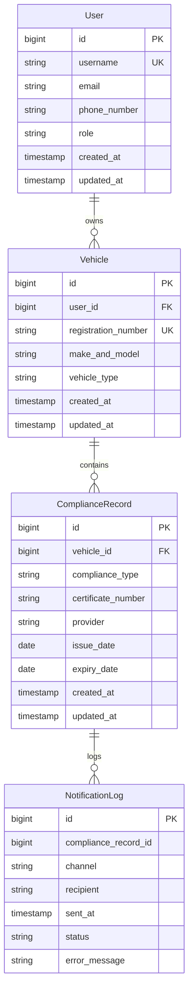

# Smart Vehicle Compliance System Backend

Production-ready backend microservice built with **Spring Boot 3**, **Java 17**, **Spring Data JPA**, and **MySQL**, featuring live vehicle data integration with RapidAPI RTO India and an automated, asynchronous reminder cron engine.

---

## 🏛️ Architecture & Entity Relationship



---

## 🚀 Key Features

1. **Real-Time RapidAPI RTO Integration Service (`RtoIntegrationService`)**:
   - Modern Spring Boot 3 `RestClient` with configurable connect and read timeouts.
   - Communicates with RapidAPI RTO endpoint (`https://rto-vehicle-information-india.p.rapidapi.com/`).
   - Resilient date parser supporting diverse RTO formats (`dd-MMM-yyyy`, `dd/MM/yyyy`, `yyyy-MM-dd`, `dd-MM-yyyy`).
   - Atomic enrollment endpoint: `POST /api/vehicles/lookup-and-enroll` fetches live vehicle info, creates vehicle records, and associates `INSURANCE`, `PUC`, and `ROAD_TAX` compliance entries.

2. **Automated Reminder Cron Engine (`ComplianceSchedulerService`)**:
   - Runs daily at **08:00 AM** (`@Scheduled(cron = "${compliance.cron.reminder-schedule:0 0 8 * * ?}")`).
   - High-performance query with `JOIN FETCH` to prevent N+1 queries.
   - Evaluates records expiring **today**, in **7 days**, or in **30 days**.
   - Dispatches custom-tailored reminder notifications asynchronously via `@Async("notificationTaskExecutor")`.

3. **Asynchronous Notification & Audit Logging (`NotificationService`)**:
   - Uses `JavaMailSender` over dedicated `ThreadPoolTaskExecutor`.
   - Records every notification attempt in the `NotificationLog` table with channel (`EMAIL`), timestamp, status (`SENT` / `FAILED`), and error logs if delivery fails.

---

## 🖥️ React Frontend Dashboard

The project includes a clean, responsive React dashboard built with **React**, **Tailwind CSS**, and **Lucide React** in the `frontend/` directory.

### Key Features:
- **4 Real-time KPI Cards**: Total Vehicles, Fully Compliant, Expiring Soon ($\le$ 30 days, Amber), and Expired / Non-Compliant (Red).
- **Live Lookup & Auto-Enrollment Modal**:
  - Validates Indian registration number format (`^[A-Z]{2}[0-9]{2}[A-Z]{1,2}[0-9]{4}$`, e.g., `TN09BX4521`).
  - Queries `POST /api/vehicles/lookup-and-enroll` with an animated loading skeleton.
  - Previews live parsed metadata (`maker_model`, `insurance_upto`, `pucc_upto`) before enrollment.
- **Compliance Audit Ledger**:
  - Filter by search query (Plate/Model), Status (All, Expiring Soon, Expired, Valid), and Document Type (`INSURANCE`, `PUC`, `ROAD_TAX`).
  - Dynamic countdown badges (e.g. *"Expires TODAY"*, *"7 days left"*).
- **Manual Trigger**: Instant *"Send Reminder Now"* button that calls the backend dispatch endpoint with real-time UI feedback toasts.

### Starting the Frontend:
```bash
cd frontend
npm install
npm run dev
```
Open [http://localhost:3000](http://localhost:3000) in your browser. (All `/api` requests are automatically proxied to the Spring Boot backend at `http://localhost:8080`).

---

## 🐳 One-Click Full-Stack Docker Deployment

The entire system (MySQL 8, Mailpit SMTP, Spring Boot 3 Backend, and React 18 + Nginx Frontend) is fully containerized and can be started with a single command:

```bash
docker compose up --build -d
```

### 🚢 Orchestrated Container Services

| Service | Container Name | Port | Description |
|---|---|---|---|
| **Frontend** | `vehicle-compliance-frontend` | `http://localhost:3000` | React 18 SPA served via Nginx with reverse proxy to `/api` |
| **Backend** | `vehicle-compliance-backend` | `http://localhost:8080` | Spring Boot 3 API service running with container JVM flags |
| **MySQL 8** | `vehicle-compliance-mysql` | `localhost:3306` | MySQL 8.0 relational database with Docker health checks |
| **Mailpit** | `vehicle-compliance-mailpit` | `http://localhost:8025` | Mock SMTP server & Web UI for inspecting audit email alerts |

### 🛑 Stopping the Stack
```bash
docker compose down
# Or to clear volumes:
docker compose down -v
```

---

## 🛠️ Local Development (Zero-Installation Mode)
|---|---|---|
| `DB_URL` | MySQL JDBC URL | `jdbc:mysql://localhost:3306/vehicle_compliance_db` |
| `DB_USERNAME` | MySQL Username | `root` |
| `DB_PASSWORD` | MySQL Password | `password` |
| `RAPIDAPI_KEY` | RapidAPI API Key | *(required for live calls)* |
| `RAPIDAPI_HOST` | RapidAPI RTO Host | `rto-vehicle-information-india.p.rapidapi.com` |
| `RAPIDAPI_RTO_BASE_URL` | RapidAPI Base URL | `https://rto-vehicle-information-india.p.rapidapi.com` |
| `MAIL_HOST` | SMTP Host | `localhost` (for Docker) or `smtp.gmail.com` |
| `MAIL_PORT` | SMTP Port | `1025` (Mailpit) or `587` |
| `COMPLIANCE_REMINDER_CRON` | Daily Cron Expression | `0 0 8 * * ?` (Daily 8:00 AM) |

### 3. Run the Application
```bash
./mvnw spring-boot:run
```

---

## 📡 API Reference & cURL Examples

### 1. Create User
`POST /api/users`
```bash
curl -X POST http://localhost:8080/api/users \
  -H "Content-Type: application/json" \
  -d '{
    "username": "rahul_sharma",
    "email": "rahul.sharma@example.com",
    "phoneNumber": "+919876543210",
    "role": "ROLE_USER"
  }'
```

### 2. Lookup & Enroll Vehicle via Live RTO
`POST /api/vehicles/lookup-and-enroll`
```bash
curl -X POST http://localhost:8080/api/vehicles/lookup-and-enroll \
  -H "Content-Type: application/json" \
  -d '{
    "registrationNumber": "TN09BX4521",
    "userId": 1
  }'
```

**Sample Response (`201 Created`):**
```json
{
  "success": true,
  "message": "Vehicle successfully enrolled with real-time RTO compliance data",
  "data": {
    "id": 1,
    "userId": 1,
    "username": "rahul_sharma",
    "userEmail": "rahul.sharma@example.com",
    "registrationNumber": "TN09BX4521",
    "makeAndModel": "HYUNDAI CRETA SX",
    "vehicleType": "Motor Car (LMV)",
    "complianceRecords": [
      {
        "id": 1,
        "complianceType": "INSURANCE",
        "certificateNumber": "POL-982341",
        "provider": "ICICI Lombard",
        "issueDate": null,
        "expiryDate": "2026-12-31",
        "daysUntilExpiry": 58,
        "isExpired": false
      },
      {
        "id": 2,
        "complianceType": "PUC",
        "certificateNumber": "PUC-56128",
        "provider": "Authorized PUC Emission Center",
        "issueDate": null,
        "expiryDate": "2026-11-10",
        "daysUntilExpiry": 7,
        "isExpired": false
      }
    ],
    "createdAt": "2026-11-03T16:00:00"
  },
  "timestamp": "2026-11-03T16:00:00"
}
```

### 3. Retrieve Vehicle by Plate
`GET /api/vehicles/{registrationNumber}`
```bash
curl -X GET http://localhost:8080/api/vehicles/TN09BX4521
```

### 4. Retrieve Vehicles by User
`GET /api/vehicles/user/{userId}`
```bash
curl -X GET http://localhost:8080/api/vehicles/user/1
```

### 5. Manually Trigger Scheduled Compliance Audit
`POST /api/vehicles/audit/trigger`
```bash
curl -X POST http://localhost:8080/api/vehicles/audit/trigger
```
Dispatches async reminder emails for all vehicles whose documents expire today, in 7 days, or in 30 days without waiting for the 8:00 AM cron trigger.

